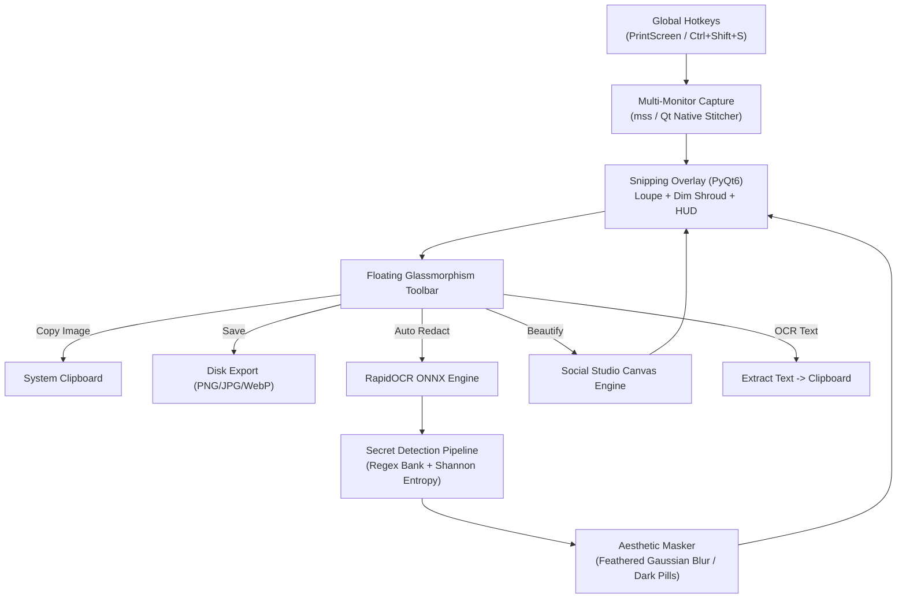

# 📸 RedactSnap

<div align="center">

```text
  ____           _            _   ____                    
 |  _ \ ___   __| | __ _  ___| |_/ ___| _ __   __ _ _ __  
 | |_) / _ \ / _` |/ _` |/ __| __\___ \| '_ \ / _` | '_ \ 
 |  _ <  __/| (_| | (_| | (__| |_ ___) | | | | (_| | |_) |
 |_| \_\___| \__,_|\__,_|\___|\__|____/|_| |_|\__,_| .__/ 
                                                   |_|    
```

### *The Privacy-First Desktop Screenshot Autopilot*
**Automatic secret redaction • 100% offline local OCR • Apple/Raycast social canvas • Zero cloud**

[](https://python.org)
[](https://riverbankcomputing.com/software/pyqt/)
[-blue)](https://github.com/RapidAI/RapidOCR)
[](https://github.com/AmhetCnaa/RedactSnap)
[](https://opensource.org/licenses/MIT)
[](tests/)

---

[Key Features](#-key-features) •
[Why RedactSnap?](#-why-redactsnap) •
[Quickstart](#-quickstart) •
[Shortcuts](#-shortcuts) •
[Architecture](#-architecture) •
[Presets](#-studio-canvas-presets)

</div>

---

## ⚡ Key Features

- **🛡️ Intelligent Auto-Redaction:** In-flight scanning for API keys (OpenAI, AWS, GitHub, Stripe, Anthropic), JWTs, emails, credit cards (Luhn validated), IP addresses, and high-entropy secrets via Shannon Entropy $H(X)$. Smooth feathered Gaussian blur or modern dark pills.
- **📝 1-Click Offline OCR ("Copy as Text"):** Extract all text from your selection straight into your clipboard using local ONNX inference models. Zero external software setup, zero cloud calls.
- **🎨 Social Studio Canvas:** Transform raw screenshots into social-media-ready graphics with Apple & Linear-grade multi-stop gradients, 3-tier diffuse soft drop shadows, rounded corners, and macOS traffic-light window frames.
- **🔍 8x Pixel Loupe:** CleanShot-grade pixel magnifier showing real-time RGB hex color codes, coordinates, and pixel grids during selection.
- **⚡ Blazing Fast (<15ms):** Instant multi-monitor virtual desktop capture with no screen lag.
- **🔒 100% Zero-Cloud:** Never sends a single byte to an external server. Completely offline, secure, and private.

---

## 🥊 Why RedactSnap?

| Feature | **RedactSnap** | **CleanShot X** | **Flameshot** | **Windows Snip** | **ShareX** |
| :--- | :---: | :---: | :---: | :---: | :---: |
| **Open Source & Free** | ✅ **Yes (MIT)** | ❌ Paid ($29+) | ✅ Yes | ❌ Proprietary | ✅ Yes |
| **Cross-Platform (Win/Linux)**| ✅ **Yes** | ❌ macOS Only | ✅ Yes | ❌ Win Only | ❌ Win Only |
| **Auto-Redact API Keys / PII** | ✅ **Automatic** | ❌ Manual | ❌ Manual | ❌ Manual | ❌ Manual |
| **Shannon Entropy Secret Detection** | ✅ **Yes** | ❌ No | ❌ No | ❌ No | ❌ No |
| **100% Offline Local OCR** | ✅ **RapidOCR (ONNX)** | ⚠️ Cloud/Native | ❌ Plugin | ⚠️ Basic | ⚠️ Tesseract |
| **Social Studio Canvas (Gradients/Shadows)**| ✅ **Built-in** | ⚠️ Basic | ❌ No | ❌ No | ⚠️ Complex |
| **Frameless Glassmorphism Toolbar** | ✅ **Yes** | ✅ Yes | ⚠️ Legacy UI | ❌ Minimal | ⚠️ Dense UI |

---

## 🚀 Quickstart

### 1. Requirements & Setup
Requires Python 3.10+ (Python 3.12 recommended with [uv](https://github.com/astral-sh/uv)):

```powershell
# Clone the repository
git clone https://github.com/AmhetCnaa/RedactSnap.git
cd RedactSnap

# Create and activate virtual environment with uv
uv venv --python 3.12
.venv\Scripts\activate

# Install package in editable mode with development & OCR dependencies
uv pip install -e ".[ocr-rapid,dev]"
```

### 2. Launching RedactSnap

#### 🔔 Background Daemon Mode (Recommended Daily Use)
Runs silently in your Windows System Tray and registers global hotkeys (`PrintScreen` or `Ctrl+Shift+S`):

```powershell
python -m redactsnap daemon
```

#### ⚡ One-Shot Capture Mode
Launches the interactive snipping overlay directly:

```powershell
python -m redactsnap capture
```

---

## 🎮 Shortcuts & Controls

```text
 ┌────────────────────────────────────────────────────────┐
 │  [📋 Copy]  [🛡️ Redact]  [🎨 Frame]  [📝 OCR]  [💾 Save] │
 └────────────────────────────────────────────────────────┘
```

| Action | Shortcut / Trigger | Description |
| :--- | :--- | :--- |
| **Trigger Snip** | `PrintScreen` or `Ctrl+Shift+S` | Opens full-screen virtual desktop overlay |
| **Select Region** | `Left Click + Drag` | Defines selection rectangle with 8x magnifier loupe |
| **Copy Image** | `Enter` or `Ctrl+C` | Copies capture to clipboard and closes |
| **Save Image** | `Ctrl+S` or `[💾 Save]` | Opens file dialog (PNG / JPEG / WebP) |
| **Cancel** | `Escape` or `Right Click` | Dismisses overlay without copying |
| **1px Nudge** | `Arrow Keys` | Moves active selection by 1 pixel (Shift for 10px) |
| **Live Redact** | `[🛡️ Redact]` | Toggles auto-redaction on the active selection |
| **Cycle Themes** | `[🎨 Frame]` | Cycles through gradient canvas presets in real-time |
| **Copy Text** | `[📝 OCR Text]` | Extracts text to clipboard with floating toast notification |

---

## 🎨 Studio Canvas Presets

RedactSnap includes curated visual presets inspired by modern design leaders:

- 🌌 **Obsidian Dark:** Linear-style deep stealth dark space (`#090D16` → `#18202F` → `#0F172A`).
- 🌅 **Sunset Warmth:** macOS Monterey dusk with royal purple, electric magenta, and warm coral.
- 🌲 **Emerald Code:** Terminal forest green, bright mint, and cyan aqua.
- 🔮 **Cyber Purple:** Raycast ultraviolet deep violet and soft lavender.
- 🌊 **Hyper Blue:** Apple keynote clean electric navy, sapphire, and sky cyan.
- 🍯 **Midnight Amber:** Titanium charcoal and warm golden honey.
- 🪟 **Transparent Canvas:** Floating window with soft drop shadows on a transparent alpha background.

---

## 🏛️ Architecture & Data Flow



---

## 🧪 Automated Testing

RedactSnap is rigorously tested with **24 unit tests** covering multi-monitor coordinate math, OpenCV masking, OCR pipeline, Shannon Entropy filters, and UI toolbar actions:

```powershell
pytest -v
```

```text
tests/test_capture.py    ...... (6 passed)
tests/test_redaction.py  ........ (8 passed)
tests/test_studio.py     ..... (5 passed)
tests/test_ui.py         ..... (5 passed)

====================== 24 passed in 3.15s ======================
```

---

## 🤝 Contributing

Contributions are welcome! Please feel free to submit a Pull Request.

1. Fork the Project
2. Create your Feature Branch (`git checkout -b feature/AmazingFeature`)
3. Commit your Changes (`git commit -m 'feat: add some amazing feature'`)
4. Push to the Branch (`git push origin feature/AmazingFeature`)
5. Open a Pull Request

---

## 📄 License

Distributed under the **MIT License**. See `LICENSE` for more information.

<div align="center">
Made with ❤️ for developers, creators, and privacy advocates everywhere.
</div>
